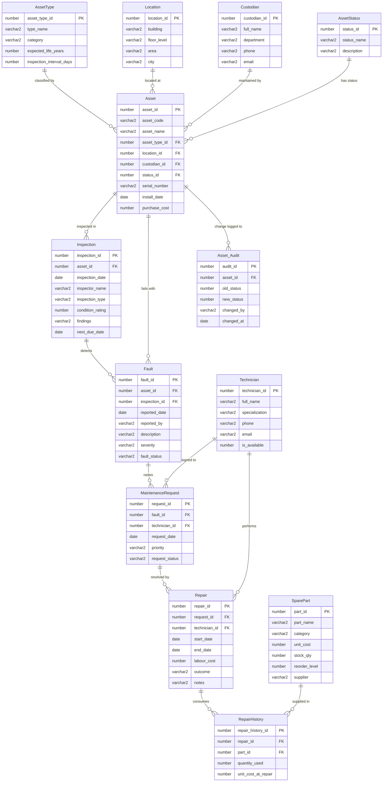

# AssetCare — ER / EER Diagram

Render this file in VS Code (with a Mermaid extension), at https://mermaid.live,
or paste the diagram into draw.io (it imports Mermaid). Screenshot the result for
the report / poster.

## Cardinalities (one-line summary)

| Relationship | Cardinality | Meaning |
|---|---|---|
| AssetType → Asset | 1:N | one type classifies many assets |
| Location → Asset | 1:N | one location hosts many assets |
| Custodian → Asset | 1:N | one custodian manages many assets |
| AssetStatus → Asset | 1:N | one status applies to many assets |
| Asset → Inspection | 1:N | one asset has many inspections |
| Asset → Fault | 1:N | one asset can fail many times |
| Inspection → Fault | 1:N | one inspection can detect many faults |
| Fault → MaintenanceRequest | 1:N | one fault raises one/more requests |
| Technician → MaintenanceRequest | 1:N | one technician handles many requests |
| Technician → Repair | 1:N | one technician performs many repairs |
| MaintenanceRequest → Repair | 1:N | one request resolved by one/more repairs |
| Repair → RepairHistory | 1:N | one repair consumes many parts |
| SparePart → RepairHistory | 1:N | one part used across many repairs (M:N via junction) |
| Asset → Asset_Audit | 1:N | one asset has many status-change records |
